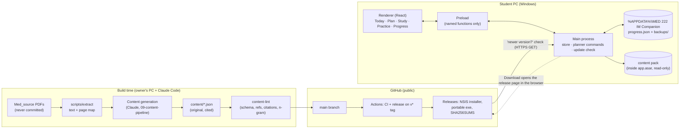

# 04 — Architecture

## 1. System diagram

## 2. Process boundaries
| Process | Owns | Never does |
|---|---|---|
| **Main** | Window and hardening; `app://` protocol; the progress store (validate → atomic write → snapshot); loading and validating the content pack; IPC commands; the release check (ADR-0008) | Business rules (it calls the shared engine); rendering |
| **Preload** | `contextBridge` → `window.imc` with named functions only | Exposing `ipcRenderer`, Node or Electron objects |
| **Renderer** | UI, study sessions and question flow; calls `src/shared/engine` for derived views (Today, progress, weak areas) | File or network access |
| **Shared** (`src/shared`) | zod schemas (content + progress), pure engine (planner, spaced repetition, scoring, routing), dates | I/O |

The **planner engine is pure**: `(content, plan config, progress events, today) → schedule state` (05 §3), as in DailyPot's ADR-0004. Schedules are **materialised once** when a plan is created or rebuilt, so dates stay stable for the student. Task *status* is always **derived** from progress events, never stored, except for explicit manual overrides.

## 3. The content pack
- It lives in `content/` in the repo, as JSON validated by `src/shared/content-schema.ts`. It's bundled into `app.asar` read-only and loaded and validated by main at startup.
- **`content/blueprint.json` ships complete in v0.1.0.** It has all 90 topics' metadata, so plans always cover the whole blueprint (05 §2.1).
- **One file per topic** (`content/topics/<topicId>.json`) keeps diffs reviewable and lets content ship system by system. A topic without a file is **pending**: its tasks show ⏳ and never go Overdue (R-6.3).
- The app version declares its **capabilities** (quizzes, practice, drills, exams, mocks, OSPE). The engine adapts completion rules to them, so early releases still log progress automatically (R-6).
- `content/manifest.json` carries `contentVersion`, generation date, the topic list with each topic's source-check date (ADR-0009), and the books list.
- Content updates ship **inside app releases** (one channel). A content-only change is a patch release (`0.3.1`). There's no separate content download, which saves a second trust path ([07](07-threat-model.md) T4).

## 4. Data location & durability (ADR-0002)
- Progress lives in `%APPDATA%\MED 222 IM Companion\progress.json`. That's local only, and there's no server.
- Writes are atomic (write temp → fsync → rename). A daily snapshot goes to `backups/` (keeps 14), plus a `pre-*` backup before any import, restore, plan rebuild or migration.
- **Export/Import** progress as a JSON file, for moving to a new PC or reinstalling.
- Content IDs are **stable forever** (topic, section, question and card IDs). Progress references them, so content updates never orphan history. A retired ID is kept in `content/retired.json`, and the engine ignores its events.

## 5. Distribution & update (ADR-0008)
- electron-builder → **NSIS installer** (per-user, no admin) and a **portable exe**, Windows x64 only (D11). Both are unsigned (D2), and SHA-256 checksums are published.
- **No auto-updater.** On launch (and via "Check for updates") main makes one GET to `api.github.com/repos/450h/im-companion/releases/latest`. If `tag_name` is newer than the app version, the app shows a banner. **Download** opens the release page in the browser, and the student runs the new installer over the old one.
  - **Campus Wi-Fi** (QA N9): the anonymous API allows 60 requests/hour **per IP**, and a whole class behind one campus NAT can exhaust it. So results are cached for 6 h, and on 403/429 the check falls back to the releases Atom feed `github.com/450h/im-companion/releases.atom` (newest entry's tag).
  - If the repo is ever renamed, GitHub answers 301 and the allowlist cancels the redirect. The banner then stays silent in old copies, so announce the rename in the class group.
- **Progress survives reinstalling** because it lives in `%APPDATA%\MED 222 IM Companion`, outside the install folder (`deleteAppDataOnUninstall: false`). The NSIS installer keeps the same `appId`, so it upgrades in place.
- The repo (`github.com/450h/im-companion`, D3) must be public for the anonymous check.
- A dev-time env var (`IMC_DISABLE_UPDATES=1`) and packaged-only gating keep dev builds from checking.

## 6. Build-time content tooling (never shipped)
- `scripts/extract/` (Python, run with `-I` on the owner's PC): extracts PDF text per page and builds a **page map** (PDF page ↔ printed page) for each book into `.work/` (gitignored). It also OCRs the scanned EMQ Volume 3 into `.work/text` (tesseract.js, dev-only).
- `scripts/content-lint.ts` (runs in CI): schema validity, unique and stable IDs, every question's `studyRef` resolves to a real section, every block has a citation to a known book and a valid page, answer ∈ options, no orphan cards, **source/copy-check hashes match** (05 §2.3), no raster images. The copy check itself (n-gram + option overlap) needs `.work/`, so it runs locally and records an attested hash that CI verifies.

## 7. One-way doors
| Door | Why it's hard to reverse | Reversal cost | ADR |
|---|---|---|---|
| **Cite-only, never ship copyrighted material** | Once a copyrighted file is in a public git history, removing it means rewriting history and re-releasing; a takedown hits the whole repo | Very high | 0003 |
| **Stable content IDs referenced by progress** | Renaming IDs orphans every student's history | High (needs a migration map) | 0004 |
| **App identity** (`appId`, productName, data-folder name) | Changing it makes Windows treat it as a new app: installs no longer upgrade in place and the data folder moves | Medium-high (needs a migration that finds the old folder) | D1 |
| Public repo location (soft door) | The release-check URL is baked into installed copies; moving the repo silences the "new version" banner in old copies | Low-medium (announce in the class group) | 0008, D3 |
| **Content license CC BY-NC-SA** | Content already released under it can't be un-licensed | Medium | 0006 |
