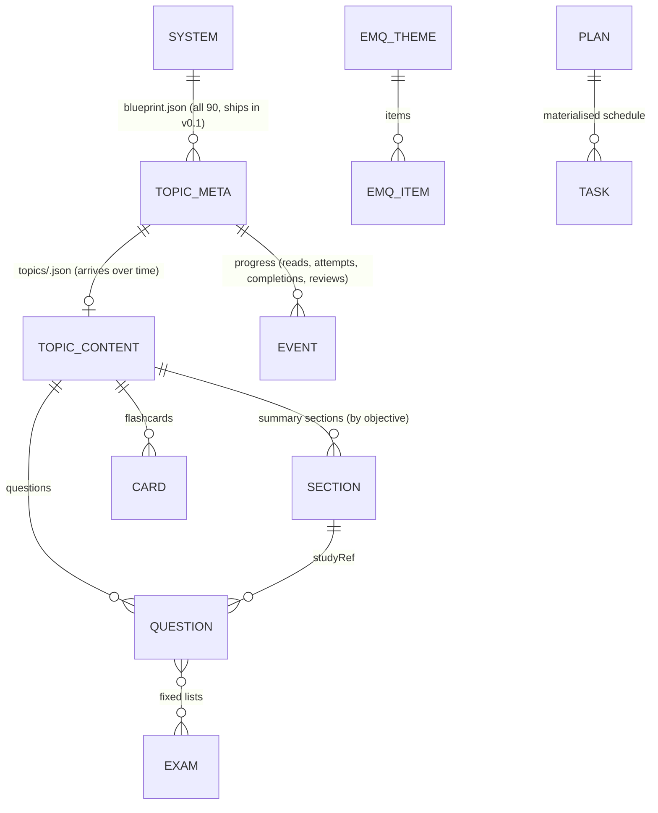
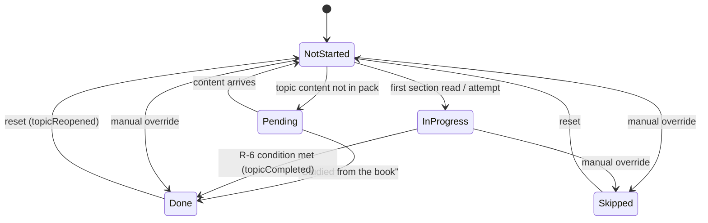
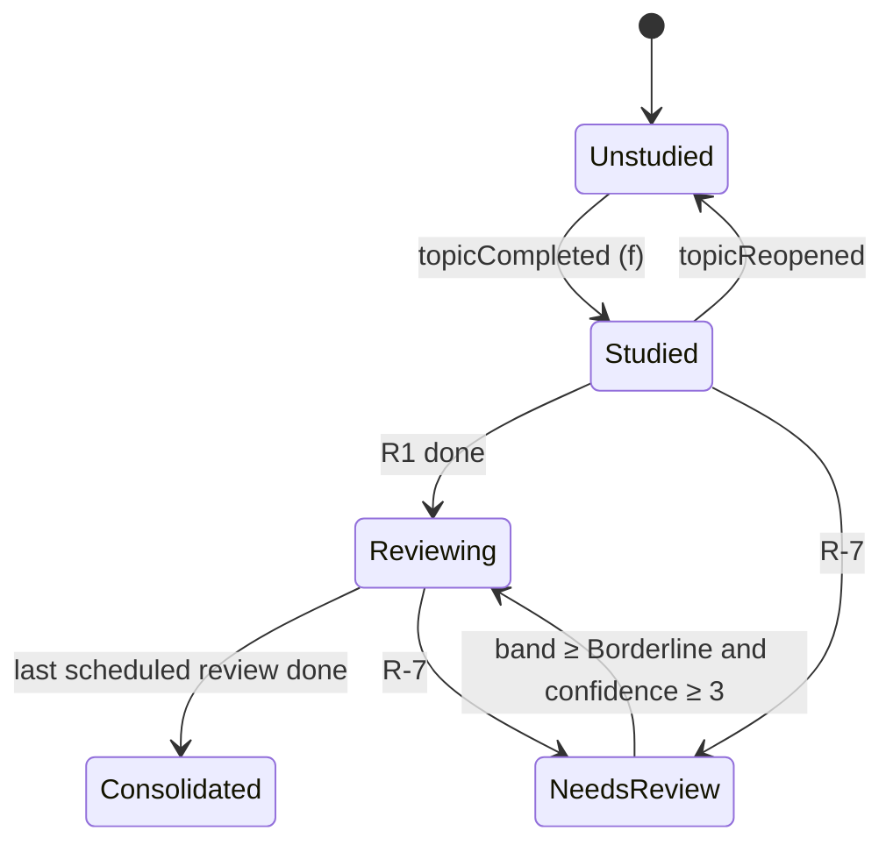

# 05 — Data model & planner engine

> **This chapter is binding.** The engine in `src/shared/engine/` must match it exactly, and every numbered rule (R-x) has a unit test.
> - The rules come from the owner's Excel planner (`Med611_Midterm_Study_Planner.xlsx`: Dashboard, Master Schedule, Revision Tracker, MCQ Tracker, Weekly Planner, Blueprint Coverage), generalised so a plan can start on any day.
> - Deliberate differences from the Excel are listed in §8.
> - _Revised 2026-10-21 after QA review (findings B1–B6, N1–N5)._

## 1. Entities overview

The **content** entities are read-only and ship in the app. The **progress** entities (plan, task, event) live in `progress.json` on the student's PC.

## 2. Content schema (`src/shared/content-schema.ts`, zod, strict)

### 2.1 Blueprint metadata: `content/blueprint.json` (complete from v0.1.0)
All **90 topics** (73 with `mid`, 17 final-only) ship in the first release, so plans always cover the whole blueprint even while content streams in. This fixes QA B2.
- Built from `scripts/seed/planner-topics.json` (extracted from the Excel) plus the blueprint PDF.
- Topic IDs are immutable from v0.1.0.

| Entity | Key fields | Rules |
|---|---|---|
| `System` | `id` (`gi`, `id`, `neph`, `cardio`, `resp`, `rheum`, `endo`, `heme`, `hemonc`, `onc`), `title`, `order` | Order = the Excel order |
| `TopicMeta` | `id` (stable slug), `systemId`, `title`, `assessedIn` ⊆ {`mid`,`final`,`osce`}, `priority` (`high`/`medium`/`standard`), `studyHours`, `objectives[]` (blueprint text), `order` | **`studyHours = max(0.5, 0.25·⌈objectives/2⌉)`**. That's exactly the Excel's rule for all 73 midterm topics, and it's applied to the 17 final-only ones. **Priority:** `standard` = History & physical; `high` = highlighted yellow in the blueprint; `medium` = the rest (Excel's values kept for midterm topics) |

### 2.2 Topic content: `content/topics/<topicId>.json` (arrives system by system)
A topic is **available** if its file is in the pack, and **pending** otherwise. Lint and source-check apply only to available topics.

| Entity | Key fields | Rules |
|---|---|---|
| `Book` (`books.json`) | `id` (e.g. `davidson24`), `title`, `edition`, `authors`, `publisher`, `year` | Closed list of the sources (09 §2). There's no file name or folder reference (ADR-0003, QA N6) |
| `Citation` | `book`, `chapter?`, `page` (printed), `pdfPage?`, `figure?`, `table?` | Shown as "Davidson's 24e · Ch 24 · p. 862". `pdfPage` is optional and shown as "(e-book p. 880)" when present |
| `TopicContent` | `topicId`, `contentVersion`, `sections[]`, `cards[]`, `questions[]`, `sourceCheck` {`passedAt`, `checkerVersion`, **`contentHash`**}, `copyCheck` {`passedAt`, `contentHash`}, `ownerReviewedAt?` | `contentHash` = SHA-256 of the canonical JSON excluding these check fields. **CI recomputes it and fails on a mismatch**, so an edit after the checks invalidates them (QA N8) |
| `Section` | `id`, `title`, `objectiveIdx[]`, `blocks[]` | A block is `para`, `bullets`, `table`, `diagram` (original SVG), `pearl`, `pitfall` or `figureRef`. **Every block has ≥ 1 cite** (a `figureRef` is itself a citation) |
| `Card` | `id`, `sectionId`, `front`, `back`, `cites[]` | Markdown subset only |
| `Question` | `id`, `kind` (`sba`/`emq`), `pool`, `quizScope?`, `difficulty` 1–3, `cites[]` | `pool` is one of: `worked` (shown solved in the reader), `quiz` (with `quizScope`: `section` or `topic`), `practice`, `exam` (chapter exams), `mock` (reserved for mock exams only). `sba`: `stem`, `options[5]`, `answer`, `explanation`, `whyNot[]`, `studyRef` {topicId, sectionId}. `emq`: `theme`, `options[8–14]`, `leadIn`, `items[2–6]` each {`stem`, `answer`, `explanation`, `studyRef`} |
| `Exam` (`exams/*.json`) | `id`, `kind` (`chapter`/`mock-midterm`/`mock-final`), `systemId?`, `title`, `minutes`, `questionIds[]` | Chapter exams use only `exam` questions; mocks use only `mock` questions. Neither pool ever appears in quizzes, practice or drills |
| `EmqTheme` (`emq-volumes.json`) | `id`, `volume` 1–3, `where` {`part`, `themeNo`, `title`, `page`, `answersPage`}, `inBlueprint`, `items[]` {`n`, `answer` (letter), `optionCount`, `topicId?`, `sectionId?`, `explanation` (original)} | **No stems or option text** (ADR-0003). An `inBlueprint` theme has ≥ 1 item with a `topicId`; items outside the blueprint (e.g. a pathology item in a medicine theme) have none. `alsoAccept` lists other letters the book accepts |

### 2.3 Content lint invariants (CI, available topics only)
- **IDs:** unique, and never reused (checked against `content/retired.json`).
- **References:** every `studyRef` resolves; every cite names a known book.
- **Answers:** `answer` in range.
- **Per section:** ≥ 2 `quiz/section` questions and ≥ 1 card.
- **Per topic:**
  - ≥ 8 `quiz/topic` questions (separate from the section quizzes);
  - ≥ 3 `worked`;
  - ≥ 10 `practice`;
  - ≥ 3 `exam`;
  - ≥ 2 `mock` for midterm topics (EMQ items count individually).
- **Chapter exams:** a chapter exam has ≥ 12 gradable items (Hemato-oncology has only 4 topics) covering ≥ 70% of the system's **available** topics.
- **Checks:** `sourceCheck.contentHash` and `copyCheck.contentHash` match the recomputed hash.
- **Images:** no raster images under `content/` except allowlisted D5 files.
- **SVG:** sanitised.
- **Size:** each topic file is ≤ 250 KB, and the pack is ≤ 25 MB.

## 3. Planner engine: plan rules
**Inputs:**
- blueprint metadata (all topics) and the set of available topics;
- `PlanConfig` {`track`, `startDate`, `examDate`, `studyWeekdays` (default Sun–Thu), `hoursPerDay` (default 5.5, range 1–12), `systemOrder`};
- progress events;
- `now`;
- `capabilities` {`quizzes`, `practice`, `drills`, `exams`, `mocks`, `ospe`}, which are the features this app version has. This fixes QA B1.

**Definitions:**
- **Study day** = a date in [`startDate`, `examDate` − 1] whose weekday ∈ `studyWeekdays`. Non-study days are rest/catch-up days.
- **Study date of a timestamp** = its local date after subtracting the **day-start hour** (setting, default **04:00**). A 00:30 session counts for the previous day, and flags change at 04:00, not midnight (QA N5).
- **Plan week #** = whole weeks from the Sunday on or before `startDate`, plus 1. Weeks run Sun–Sat, as in the Excel.

### R-1 Phases
`D` = number of study days.
- `D = 0` → **refuse** ("No study days left before the exam").
- **Final** = the last `min(2, D)` study days.
- **Consolidate** = the preceding `round(0.25·D)` study days if `D ≥ 7`, else 0.
- **Learn** = the rest. If Learn = 0, use **cram mode** (R-2.4).

*With a start of 21 Oct and the defaults this gives Learn 20 / Consolidate 7 / Final 2, identical to the Excel.*

### R-2 New-study placement
Topics in scope (R-9) are taken in `systemOrder`, then `order`. Let `H` = Σ `studyHours` and `L` = Learn days.
1. **Proportional placement** (always fits, no spill; QA B3):
   - topic `i` goes on Learn day `min(L−1, ⌊L · cumHoursBefore_i / H⌋)`;
   - daily load ≈ `b = H/L`, ± one topic.
   - *With a start of 21 Oct, every system's first study day equals the Excel's.*
2. **Capacity check:**
   - **Warning:** when `b > 0.7·hoursPerDay`.
   - **Skim conversion:** when `b > 0.9·hoursPerDay`, convert topics to **skim** (`0.5·studyHours`, min 0.25) in this order: `standard` first, then `medium`, each by descending `order`. Stop as soon as `b ≤ 0.9·hoursPerDay`. `high` topics are never skimmed.
   - **Over capacity:** if all `standard` and `medium` topics are skimmed and `b > hoursPerDay`, the plan is still generated. It's marked **over capacity**, with the required hours per day shown.
3. **Remaining capacity** for a day = `max(0, hoursPerDay − dayNew)`. It's never negative.
4. **Cram mode** (Learn = 0): every in-scope topic becomes a **rapid-review** task (`0.25·studyHours`, min 0.25), spread proportionally over all study days.

### R-3 Daily fill (Learn days)
From the remaining capacity, in this order, each only if ≥ 0.25 h is left:
1. **OSPE practice**:
   - Midterm track with the `ospe` capability only.
   - Duration: `min(0.5, rem)`.
   - Content: the cited figure list and images for the topics studied in the last 3 study days.
   - Replaces the Excel's daily slide-image sessions.
2. **Questions**: `min(1.5, rem·0.5)` (QA N1):
   - Covers the **3 most recently studied topics at the time of doing it**, falling back to the planned topics of the previous Learn day.
   - Target: `min(⌈15·h⌉, unseen practice questions on those topics)`.
   - Only `practice`-session attempts count.
   - Without the `practice` capability it's a **manual** task (tick when done).
3. **Weekly Weak Areas** (`0.5` h): on the last study day of each plan week, as in the Excel.
4. **Review slot**: the rest. It's capacity only, not a task: it has no status and isn't counted in progress (R-8). Due reviews (R-5) are shown in it.

**Session numbers:** S1, S2, … in the order new study → OSPE → questions → weak areas. There's no S4 cap.

### R-4 Consolidate and Final days
- **Consolidate** (in order):
  - one **chapter exam** per system, spread evenly with 1 h each (needs `exams`; manual otherwise);
  - a **review slot** of ≥ 1 h every day (QA B5);
  - **Weak Areas** (1 h);
  - **Questions** mixed over that day's examined systems (the rest).
- **Mocks** go on the **last two Consolidate days** (QA B6):
  - day C−1: mock paper 1 + review of the mock;
  - day C: mock paper 2 (if present) + review;
  - this leaves time to act on the result before the Final days. They need `mocks`; without it they become a Questions task.
- **Final**:
  - **Final revision** (rapid review) split across the Final days by system (all systems), plus one **Weak Areas** task per day;
  - no New Study, exams or mocks.
- **Exam day**: one non-actionable `exam` task.

### R-5 Spaced reviews (derived, from the Revision Tracker's "1, 3, 7, 14 days")
For each topic with completion date `f` (R-6.1):
- `due_k = f + [1, 3, 7, 14][k]`, then moved forward to the next study day.
- If `due_k` falls on or after the first Final day, re-target it to a Consolidate day:
  - clamped reviews are **spread round-robin over all Consolidate days** (in topic order), not piled onto the last one (QA B5);
  - with no Consolidate phase, the last Learn day is used.
- If the re-targeted date is ≤ `f` or ≤ `due_{k−1}`, **drop** that review.
- **Completion:** each completed `review` session for a topic **consumes the earliest undone R_k with `due_k − 1 ≤ session study date`**, so one session completes one review only.
- A review is **Overdue** when `today > due_k` and it isn't done.
- **Planned hours** per review: `max(0.25, 0.25·studyHours)`.

### R-6 Status (derived from events; ADR-0007)
**R-6.1 Topic completion is an event, not a re-derivation** (QA B4):
- **Conditions** for New Study complete:
  - every section of the topic has a `sectionRead`;
  - and, **if** the app has the `quizzes` capability and the topic has `quiz/topic` questions, a completed `topic-quiz` session.
- When the conditions are first met, main appends `topicCompleted {topicId, at, contentVersion, source: "auto"}`.
- A manual **Done** (or **"Studied from the book"** on a pending-content topic) appends `topicCompleted {source: "manual"}`.
- A **Reset** appends `topicReopened {topicId, at}`.
- `f` = the study date of the latest `topicCompleted` that has no later `topicReopened`.
- A later content update (e.g. a new section) **never** un-completes a topic.

**R-6.2 Task status:** the latest override for the task (`done`/`skipped`) wins. `reset` clears earlier overrides. Otherwise:

| Task type | Done when | In progress when |
|---|---|---|
| New Study | Every topic in the task has `f` (R-6.1) | Any section read |
| Skim / rapid review | A `rapid-review` session completed for each topic in the task, on or after the task date | Any |
| Questions | ≥ target attempts in `practice` sessions on the resolved topics since the task date (manual without `practice`) | ≥ 1 attempt |
| OSPE practice | An `ospe` session completed on or after the task date | Started |
| Review R_k | R-5 | — |
| Chapter exam / mock | That exam session completed | Started |
| Weak Areas | A `weak-drill` session completed on or after the task date (manual without `drills`) | Started |
| Final revision | Rapid-review sessions for every topic of the task's systems, on or after the task date | Any |

**R-6.3 Content pending** (QA B2):
- A New Study task whose topic content isn't in the pack has the status **⏳ Content pending**. It's never Overdue and is excluded from the rebuild trigger.
- It shows "arrives in a coming update" and offers **"Studied from the book"** (→ R-6.1 manual).
- When the content arrives, the task behaves normally from then on. If its date has passed, it's shown as **"Catch up"** (amber) rather than ⚠ Overdue for 3 study days.

**R-6.4 Flags** (Excel column N):
- `✔ Done`;
- `⏳ Pending`;
- `⚠ Overdue` (date < today and not done/skipped/pending);
- `● Today`;
- otherwise `Upcoming`.

### R-7 Accuracy, confidence & weak areas
- **Topic accuracy** = correct / graded attempts on that topic's questions, across all modes, including EMQ items and mapped EMQ-volume items.
- **Bands:**

| Band | Rule |
|---|---|
| `Not started` | 0 attempts |
| `⚠ Weak` | < 60% |
| `Borderline` | 60–74% |
| `✔ Strong` | ≥ 75% |

- **Confidence** = the latest 1–5 rating, asked after each review session and editable anytime.
- **Needs review** = studied **and** (Weak with ≥ 5 attempts **or** confidence ≤ 2).
- **Weak drill / Weak Areas topic choice:**
  - Needs-review topics first, then Borderline.
  - **If none, the 3 lowest-accuracy studied topics** (QA N2), so the task can always complete.
  - Ordered by accuracy ascending, then by the oldest last attempt.
  - 15 questions, preferring previously-wrong, then unseen.
- **Question pools:** drills, practice and quizzes draw from `worked`/`quiz`/`practice` only, **never `exam` or `mock`**.

### R-8 Progress figures
- **Planned hours** = Σ materialised task hours (review slots excluded) + Σ derived review hours (R-5). **Done hours** use the same terms, so slot hours are never double-counted (QA B5).
- **Overall progress** = done hours / planned hours.
- **Topics studied** = topics with `f` / topics in scope.
- **Progress by system**, **weekly completion** (plan weeks), **hours by task type**, **overdue count**, **Next up** (the next 10 not-done tasks), **accuracy** overall and by system.
- **Revisions completed** = done reviews / scheduled (not dropped) reviews.
- **Days to exam** and **study days left**.

### R-9 Tracks
**Midterm:**
- `examDate` 2026-12-01.
- Default start: the first-run date.
- Scope: the 73 `mid` topics.
- Mocks: `mock-midterm` (EMQ).

**Final:**
- `examDate` 2027-01-05. Default start: the day after `midterm.examDate`.
- **It can only be created on or after `midterm.examDate`** (a preview is allowed earlier), so "studied" isn't frozen too early (QA N3).
- **Scope:** all 90 topics.
  - **New Study** = the 17 final-only topics, plus any midterm topic without `f`.
  - **Revision pass** = each midterm topic with `f` (`0.4·studyHours`, min 0.5). Ordered: Needs review → Weak → Borderline → oldest last activity.
  - New and revision tasks are **interleaved 1:1**, and both count in `H` for R-2.
- A completed Revision pass appends `topicCompleted {source: "revision"}`, which restarts R-5 for the Final track. Accuracy history carries over.
- Mocks: `mock-final` (SBA).

**Both tracks:**
- After a track's `examDate`, its plan is **archived**: read-only, with no overdue counts or prompts.
- The active track is the one with the nearest future `examDate`.
- **Flashcard due dates cap at the active track's `examDate − 1`** (R-11).

### R-10 Plan creation & rebuild
- Creation **materialises** tasks (date, session, type, topics, planned hours, `skim` flag).
- **First-run "already studied" step** (QA N11): the student can tick topics already studied (e.g. from the Excel). Each tick appends `topicCompleted {source: "manual", at: chosen date}`, and those topics are excluded from New Study.
- **Rebuild from today** (writes a `pre-rebuild` backup first):
  - keeps done tasks and all events;
  - drops not-done future and overdue tasks;
  - regenerates from today for topics without `f`.
- **Offered when:** overdue planned hours (excluding ⏳ pending) > 1.5·`hoursPerDay`. Changing weekdays or hours, or "Studied from the book" on many topics, also offers a rebuild.

### R-11 Flashcards (derived; small SM-2 variant)
Per card: `ease` starts at 2.5 and `interval` at 0.

| Grade | Interval | Ease |
|---|---|---|
| **Again** | 0 (due again this session) | −0.2 |
| **Hard** | `max(1, round(interval·1.2))` | −0.15 |
| **Good** | 1 if interval was 0 · 3 if it was 1 · else `round(interval·ease)` | — |
| **Easy** | `round(Good·1.3)` | +0.15 |

- Ease is clamped to [1.3, 3.0].
- `due = study date of last review + interval`, capped at the **active** track's `examDate − 1`.
- Cards become reviewable once any section of the topic is read.

### R-12 Wrong-answer routing
Every wrong answer shows:
1. the **study link** (`studyRef`), which opens the section with a "you missed this" highlight;
2. the **citations**;
3. `whyNot` for the chosen distractor.

Results screens group misses by section and offer "Add to weak drill".

**Answer submission** (QA N4):
- In **tutor** modes (quizzes, practice, drills) each item is answered once.
- In **exam** modes (chapter exams, mocks) answers are **last-answer-wins until `session:complete`**, then they're graded together.

## 4. Progress store (`progress.json`, `src/shared/progress-schema.ts`)
```
{ schemaVersion: 1, createdAt, settings, plans: { midterm?, final? }, events: { … } }
```
| Collection | Fields | Notes |
|---|---|---|
| `settings` | `theme`, `fontScale`, `dayStartHour` (0–6, default 4), `firstRunDone`, `disclaimerAcceptedAt`, `updates` {`checkOnLaunch`, `dismissedVersion?`, `lastCheck?` {at, latest}} | Written via `settings:*` |
| `plans.<track>` | `PlanConfig` + `generatedAt`, `archivedAt?`, `tasks[]` {`id`, `date`, `session`, `type`, `topicIds[]`, `systemId?`, `examId?`, `title`, `plannedHours`, `skim?`, `target?`} | Written only by `plan:create` / `plan:rebuild` / archive |
| `events.sectionReads` | `topicId`, `sectionId`, `at` | On scroll-to-end or "Mark read" |
| `events.completions` | `topicId`, `type` (`completed`/`reopened`), `source` (`auto`/`manual`/`revision`), `at`, `contentVersion?` | R-6.1. `auto` is appended by main only |
| `events.sessions` | `id`, `kind` (`section-quiz`, `topic-quiz`, `practice`, `review`, `rapid-review`, `weak-drill`, `ospe`, `exam`, `emq-volume`), `topicId?`, `systemId?`, `examId?`, `startedAt`, `completedAt?` | |
| `events.attempts` | `id`, `sessionId`, `questionId`, `item?`, `choice`, `correct`, `ms`, `at` | `correct` is **computed by main** |
| `events.cardReviews` | `cardId`, `grade`, `at` | |
| `events.confidence` | `topicId`, `value` 1–5, `at` | |
| `events.overrides` | `taskId`, `status` (`done`/`skipped`/`reset`), `at` | |
| `events.reflections` | `track`, `weekStart`, `wentWell`, `improve`, `adjust` | Weekly review box |
| `events.notes` | `id`, `topicId`, `sectionId?`, `text` (≤ 2,000), `at` | |

Timestamps are ISO-8601 with an offset. Study dates follow §3 (day-start hour). Events are append-only, except deleting a note.

## 5. Authorization model (IPC)
- There's one local user and no lock. Control comes from the IPC allowlist plus validation in main:
  - a zod schema per command;
  - referential checks (topic, section, question, card, exam and task exist);
  - timestamps no later than `now + 1 day`.
- **Fields only main writes:** `createdAt`, `schemaVersion`, plan `tasks`, `generatedAt`, `archivedAt`, attempt `correct`, `completions` with `source: auto|revision`.

## 6. State machines



## 7. Durability, migration & downgrade
- Every write goes through `store.commit()`: validate → temp → fsync → rename, coalesced ≤ 1 per 500 ms and flushed on quit.
- The first write of each day writes a snapshot (14 kept). `pre-import`, `pre-restore`, `pre-rebuild` and `pre-migration` backups are written before those actions.
- A corrupt file → load the newest valid snapshot, keep `progress.corrupt-<ts>.json`, and show a banner.
- Migrations are forward-only, with a test. A **newer** `schemaVersion` → open **read-only** with an "update the app" banner.
- Events referencing IDs in `content/retired.json` are ignored in statistics but kept on disk.

## 8. Deliberate deviations from the Excel (QA B6)
| Excel | App | Why |
|---|---|---|
| Fixed dates from 21 Oct | Generated from the student's start date (R-1/R-2). With the 21 Oct defaults the phases (20/7/2) and each system's first study day match the Excel | Students start on different days |
| Up to 4 topics on one day (e.g. 4 Neph topics on 28 Oct) | Proportional placement, daily load ≈ `b` ± one topic | Even days, no spill |
| Review dates fixed from the planned study date | From the actual completion date (R-5); clamped reviews spread over Consolidate | Follows real pace |
| Two mocks + reviews on 25–26 Nov | Mocks on the last two Consolidate days (same position) | Same |
| Daily OSPE/slide practice | OSPE practice task (R-3), from cited figures and D5 images | The app can't show book images (ADR-0003) |
| Sessions up to S8 | Sessions numbered sequentially, no cap | Same |
| Weekly Weak Areas in Learn | Kept (R-3.3) | Same |
| Weak = < 60% from any number of attempts | "Needs review" needs ≥ 5 attempts when based on accuracy | Avoids flagging after one wrong answer |
| Status set by hand in a dropdown | Derived from activity, with manual override | Owner requirement: automatic logging |

**Golden tests (v0.1.0):**
- starts on 21 Oct, 25 Oct, 10 Nov and 22 Nov with the defaults, and a start on the exam date (refused);
- exact expected values (phase counts, every system's first day, skim/over-capacity outcome, daily loads) are computed once, reviewed, and committed as fixtures.
